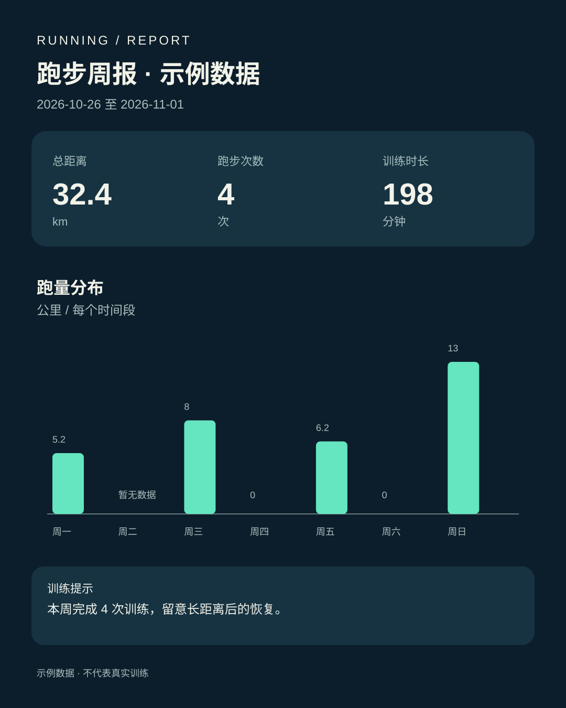

# 跑步教练 Running Coach

把 Garmin 与 RQrun 的跑步记录整理成图表报告，并结合训练和恢复数据给出简短建议。适合希望复盘跑量、比较两端同步记录的跑友。

> **项目状态：开发预览。** 两个 MCP 已分别完成本地协议冒烟测试，报告模板已用模拟数据测试；ChatGPT 中的真实账号、定时任务和通知尚未完成端到端验证。欢迎先试用并反馈，不要依赖它作为唯一训练依据。



## 可以做什么

- 读取 Garmin 和 RQrun 的训练记录，识别可能的重复活动，避免将同一次跑步算两遍。
- 按日、周、月、年设计图表为主的复盘；Skill 可按数据选择跑量柱状图、强度分布、恢复趋势、单次分段与平台对比等展示，并可使用 ECharts、Plotly 等宿主可用的工具。内置 SVG 只是基础后备模板，丰富图表的实际生成取决于运行环境。
- 结合已有计划、训练负荷和恢复信息，给出有依据的简短建议；缺少数据时说明限制。
- 根据用户要求引导设置周期报告和训练提醒；实际能否定时、交付及通知取决于所在平台的能力和权限。

## 使用前准备

本项目是 Skill，负责分析流程和报告；数据来自两个独立的 MCP：

| 数据源 | 项目 | 用途 |
| --- | --- | --- |
| Garmin | [garmin-mcp](https://github.com/hongshunanhai/garmin-mcp) | 训练、睡眠、恢复等数据 |
| RQrun | [rqrun-mcp](https://github.com/hongshunanhai/rqrun-mcp) | 跑步记录、跑力和训练分析 |

首次使用时 Skill 会检查可用工具，并引导安装或连接缺失的数据源。可以先只连接一个；两个数据源的登录、权限和数据可用性各自独立。请先阅读对应项目的安装说明和许可证：Garmin MCP 使用非商业许可证，其约束独立于本项目。

## 安装与首测

### Codex 本地

1. 下载本仓库，将完整的 `plugins/running-coach/skills/running-coach` 目录复制到用户级 Skill 目录 `~/.agents/skills/running-coach`，或项目级目录 `.agents/skills/running-coach`。保留其中的 `references`、`scripts` 和 `examples`。
2. 开启新会话，输入：`使用 running-coach，帮我连接 Garmin 和 RQrun，生成本周跑步报告。`
3. 按提示检查或安装两个 MCP、完成登录，再检查首次报告的数据来源和区间。已有的 MCP 不需要重装。

### ChatGPT

仓库包含用于本地测试的 ChatGPT 桌面插件与 marketplace。以下是**待端到端验证的安装路径**，不是已经验证的一键安装：

1. 下载或克隆本仓库，在仓库根目录执行 `codex plugin marketplace add .`，将本地 marketplace 加入 Codex 配置。
2. 重启 ChatGPT 桌面 App，在 Work 的插件目录中选择“跑步教练”来源，找到“跑步教练”并点击安装。开启本地 Work 会话，运行插件的设置或选择该 Skill。
3. 按引导分别连接 Garmin 和 RQrun，并在新对话里验证两边都能读取活动，再生成第一份周报。

这条路径需要本机安装 Codex CLI，可能受账号、版本和工作区权限影响。安装 Skill 不会自动安装或登录两个 MCP。Codex 的本地 MCP 配置不会自动等同于 ChatGPT 的插件连接；Garmin 支持 HTTP，RQrun 使用本地 stdio。具体接入参考 [首次接入](plugins/running-coach/skills/running-coach/references/setup.md) 和 [OpenAI 插件打包文档](https://developers.openai.com/plugins/build/plugins)。本仓库发布到 GitHub、安装和首测验证后，才能给出真实的 GitHub 地址和确认可用的快捷安装命令。

### 试试这样说

```text
用我的 Garmin 和 RQrun 数据做一份上周跑步报告，以图表为主。
比较昨天那次跑步在两个平台的距离和配速，有差异就解释可能原因。
结合最近的训练和恢复情况，给我明天的训练建议。
如果当前平台支持定时任务，每周一早上 8 点给我上一周的报告，时区为上海。
```

先检查一次手动报告，再设置定时任务。运行依赖本地文件时，定时任务的运行条件取决于宿主；登录过期或设备未同步时报告可能不完整。

## 本地查看示例图

需要 Python 3，无额外绘图库：

```bash
python3 plugins/running-coach/skills/running-coach/scripts/render_report.py plugins/running-coach/skills/running-coach/examples/sample.json report.svg
```

`sample.json` 和示例图仅为模拟数据。实际报告需要先读取并核实用户数据，再按样例结构填入；模板不会自动连接账号。敏感数据不要提交到 GitHub。

## 隐私与使用边界

账号密码只应输入各平台官方登录页面，不要粘贴密码、验证码、Cookie 或令牌。数据会交由用户选择的 AI 客户端及其模型处理；分享报告前请检查内容。训练建议不构成医疗诊断，身体不适或伤病时应优先考虑休息并寻求专业帮助。

## 反馈与验证

提交问题时请描述平台、操作步骤和报错，先移除账号、位置轨迹、健康数据和凭据。项目的验证步骤和发布前检查见 [CONTRIBUTING.md](CONTRIBUTING.md)。

本项目采用 [PolyForm Noncommercial License 1.0.0](LICENSE)：个人非商业使用请遵守许可证条款；其他使用方式请先联系版权人取得授权。许可证允许用途以完整条款为准。两个 MCP 的许可证各自独立。
